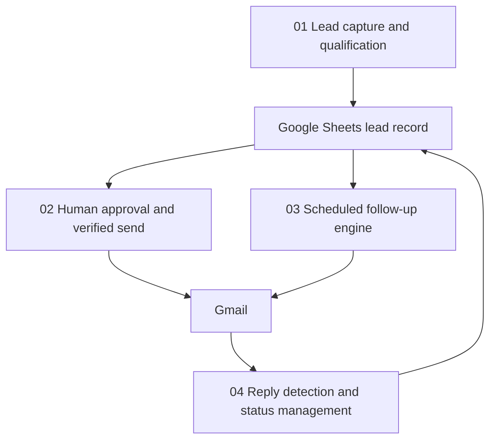

# Modular AI Lead Management System

Four modular n8n workflows for lead capture and AI qualification, human approval and verified sending, scheduled follow-up, and reply/status management.

> Portfolio project: the repository contains separate workflow exports. Import and configure them as a coordinated system; they are not automatically linked in a new n8n instance.

## At a glance

| Area | Implementation |
|---|---|
| Orchestration | n8n |
| AI generation | Google Gemini via HTTP Request |
| Lead data | Google Sheets |
| Email | Gmail |
| Workflow modules | 4 exports, 69 nodes total |

## Architecture

## Workflow modules

| Module | Nodes | Responsibility |
|---|---:|---|
| `01-lead-capture-qualification-draft.json` | 33 | Accepts and normalizes leads, qualifies them, drafts email, and records lead data |
| `02-human-approval-verified-send.json` | 12 | Validates an approval action and sends the approved message |
| `03-automated-follow-up-engine.json` | 12 | Selects eligible leads, generates follow-up content, sends, and updates status |
| `04-reply-detection-status-management.json` | 12 | Detects replies and updates lead status |

## Requirements

- n8n with Google Sheets, Gmail, Webhook, Schedule Trigger, and HTTP Request nodes.
- Google Gemini API access.
- A Google Sheet configured with the fields referenced by all four workflows.
- A reachable n8n base URL for webhook and approval interactions.

## Setup

1. Import each JSON file as a separate workflow.
2. Create and assign your own Google Sheets and Gmail credentials.
3. Configure Gemini HTTP authentication with n8n credentials; do not hardcode API keys in workflow JSON.
4. Set the same spreadsheet ID, sheet names, owner email, booking URL, n8n base URL, and approval path wherever referenced.
5. Set the approval workflow endpoint to match the path expected by the lead-capture workflow.
6. Configure Gmail reply detection and the follow-up schedule.
7. Test with a dedicated sheet and mailbox before enabling live sends.

## Validation status

The repository contains four modular workflow exports. This README does not claim a live end-to-end runtime test. Verify module-to-module webhook wiring, sheet column consistency, approval replay behavior, duplicate prevention, follow-up eligibility, reply detection, and opt-out handling.

## Operational considerations

- Google Sheets check-then-update patterns may race under concurrent execution; do not treat them as atomic locks.
- Keep approval and send paths idempotent where possible.
- Use test recipients until all branches and failure paths have been exercised.
- Never commit API keys, OAuth tokens, private sheet IDs, or customer records.

## Next steps

Add a redacted architecture/execution demo, verified test evidence, and a deployment-specific configuration example after runtime validation.

## License

No license is specified. Contact the repository owner before reusing this project.
